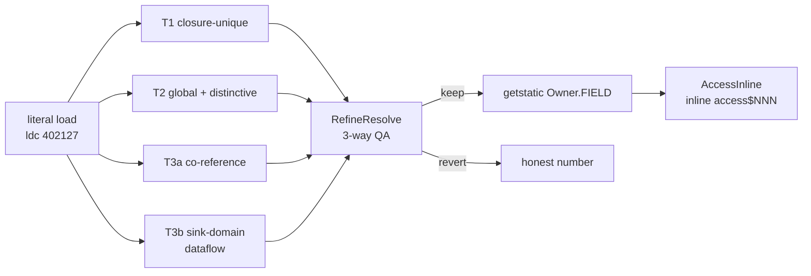
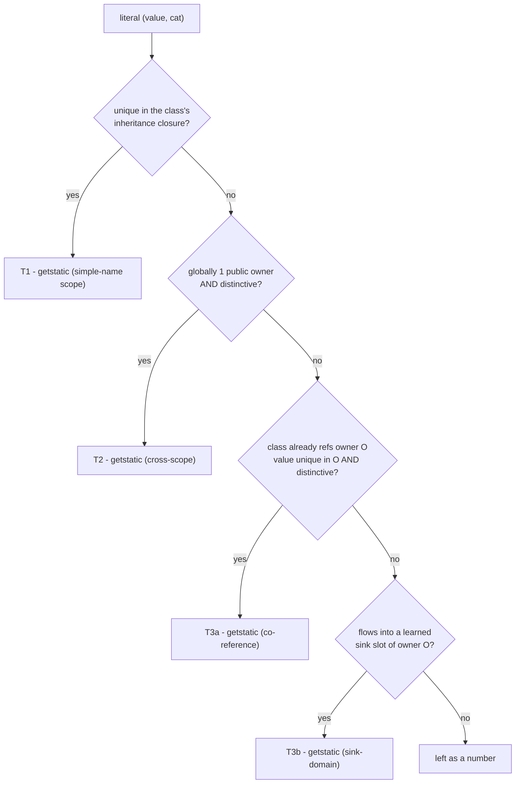
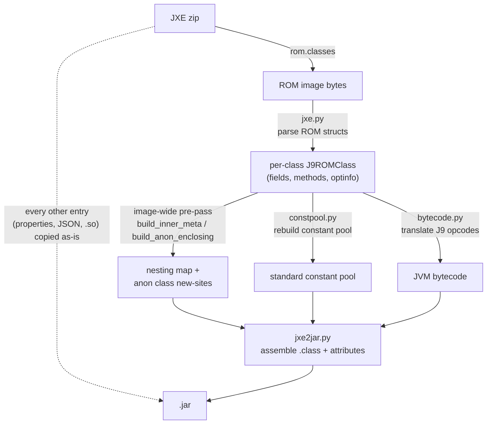

# jxe2jar

Tools and notes for converting **IBM J9/CDC JXE (rom.classes)** images back to standard
Java `.class` / `.jar`, then decompiling them into *readable* Java - with inlined
`static final` constant **names recovered** at the bytecode level.

The JXE is a romized image: J9 strips `StackMapTable`, line numbers, local-variable names
and folds `static final` constants into raw literals. This project undoes what *can* be
undone (structure, generics, inner classes, `throws`, constant names) and is honest about
what the ROM erased for good (real local names, line numbers).

## Contents

- [Pipeline at a glance](#pipeline-at-a-glance) - end-to-end diagram + one-shot commands
- [Repository Structure](#repository-structure)
- [Decompilation Workflow](#decompilation-workflow) - the 6 numbered steps
- [Constant un-inlining (ASM)](#constant-un-inlining-asm---recover-inlined-static-final-names) - tiers, the **distinctiveness gate**, sink-domain fixpoint, 3-way QA
- [Decompiler reference](#decompiler-reference) - full Vineflower / CFR option sets (per-tool docs in [`tools/README.md`](tools/README.md))
- [How conversion works](#how-conversion-works) - converter internals: [J9 opcode space](#the-j9-opcode-space--srcbytecodepy), [what `jxe.py` reads](#what-jxepy-reads-out-of-each-rom-class), and every classfile fixup
- [Testing Workflow](#testing-workflow) - [Usage Notes](#usage-notes) - [See Also](#see-also) - [Credits](#credits)

## Pipeline at a glance

Two independent halves: **converter** (`src/`, JXE -> verifiable `.jar`) and **recovery +
decompile** (`tools/`, `.jar` -> readable Java). The un-inliner sits *between* conversion
and decompilation - it rewrites selected folded literals into `getstatic Owner.FIELD` so the
decompiler prints candidate names whose values are verified. End-to-end, one image:

```sh
tools/uninline/build.sh                                                     # once (JDK 17+)
python3 src/jxe2jar.py in.jxe out/base.jar                                 # convert
tools/combine.sh out/base.jar out/combined.jar --appimg <APPIMG>           # + bundles & app jars
python3 tools/donor_lvt.py apply out/combined.jar libs/donor/mh2p-lvt.json.gz -o out/combined-lvt.jar  # names from MH2p
tools/uninline/uninline.sh pipeline out/combined-lvt.jar out/final.jar out/doubtful.tsv 100
bash tools/vineflower.sh out/final.jar out/final-vf                        # decompile
python3 tools/nav_index.py out/final.jar out/nav                           # navigation index
```

## Repository Structure

| Path | Description |
|------|-------------|
| `src/` | **JXE -> JAR converter** (Python): `jxe.py` (ROM parser), `constpool.py` (constant pool), `bytecode.py` (J9 -> JVM bytecode), `jxe2jar.py` (classfile assembly + CLI), `common.py` |
| `tools/uninline/` | **ASM constant/accessor recovery suite** - self-contained fat jar (`Uninliner` - `SinkResolve` - `RefineResolve` - `AccessInline` - `VerifyResolve` - `TypeAudit`). See its [README](tools/uninline/README.md) |
| `tools/` | Merge (`combine.sh`), decompile drivers (`vineflower.sh`, `cfr.sh`) and post-processors (`decompile_fallback.py`, `fix_vf_artifacts.py`, `int2hex.py`, `nav_index.py`, `xref.py`) |
| `libs/` | 5 curated SDK jars (osgi.framework, osgi.util.tracker, commons.logging, xerces, commons-codec), fed to Vineflower as `--add-external` (type resolution) |
| `jvms/` | Bundled runtimes: Zulu **JDK 8** (mac/linux/win - the target 1.2/1.3 stdlib) + WM5 emulator for `jar2jxe` |
| `test/custom_edgecases/` | Edge-case suite (Java 1.2, 54 classes) validating the converter via **JAR -> JXE -> JAR** round-trip; new cases are romized unattended with [`tools/wm5/`](tools/wm5/README.md) |
| `vms/` | XP VM + WM5 emulator hosting the legacy `jar2jxe.exe` (round-trip direction) |
| `out/` | Conversion outputs, decompiled trees, logs, nav indexes |

## Decompilation Workflow

The converter only produces `.class`/`.jar`; turning that into readable Java is a separate
pipeline built around Vineflower (VF), with CFR as a fallback. The **constant un-inliner runs
between conversion and decompilation** - it is the step that makes the output read like source
instead of a wall of magic numbers.

1. **Convert** the JXE to a JAR:
   ```
   python3 src/jxe2jar.py input.jxe out/base.jar
   ```
   Converts *every* ROM class in the image, including the JDK / `java.*` ones.

2. **Combine** the lsd base with the firmware's OSGi bundles and app jars into one jar:
   ```
   tools/combine.sh out/base.jar out/combined.jar --appimg <APPIMG>
   ```
   `<APPIMG>` is the app image root (`.../advanced/<MODEL>-appimg`); it auto-adds `eso/bundles`,
   `eso/bundles_prod`, `eso/hmi/lsd/jars` (lsd wins name collisions). Folding them in *before*
   the un-inliner gives cross-corpus constant recovery and lets Vineflower resolve all app code
   intra-jar (no `--add-external` for it). Skip if you only want the bare lsd.
   The bundle jars were built by javac 1.1-1.4, which never wrote `EnclosingMethod`; without it
   Vineflower emits every anonymous class as a standalone `Outer$N.java` with a dangling `this$0`
   (MU1316: 631 files, 507 of them not compiling, 45% of all compile failures). `combine.sh` therefore
   ends with `tools/add_enclosing_method.py`, which recovers the enclosing class and method from the
   single `new Outer$N` site exactly as the converter does for ROM classes (644 classes on MU1316, 3 s).

3. **Graft local-variable names from the MH2p donors**, then **recover inlined constant names**
   with the ASM un-inliner - both **before decompiling**:
   ```
   python3 tools/donor_lvt.py apply out/combined.jar libs/donor/mh2p-lvt.json.gz -o out/combined-lvt.jar
   tools/uninline/uninline.sh pipeline out/combined-lvt.jar out/final.jar out/doubtful.tsv 100
   ```
   The donor goes first because it matches methods by bytecode fingerprint and the un-inliner
   rewrites `ldc` into `getstatic` (37807 exact matches on the combined jar vs 36076 after
   un-inlining); ASM carries the grafted `LocalVariableTable`s through the rewrite untouched
   (66032 methods with an LVT before and after; the verifier reports exactly the same classes
   with and without the graft). See
   [Donor names](#donor-names-localvariabletable-from-mh2p--toolsdonor_lvtpy-libsdonor).
   `javac` folds `static final` constants into raw literals, so a naive decompile shows
   `getChoiceModel(402127)` instead of a symbolic name. This pipeline rewrites selected literal
   loads into `getstatic Owner.FIELD` (value-preserving, decompile-only), so Vineflower
   then prints candidate names - **no regex over source text**. Every rewrite is proven
   `value(F) == literal` (0 mismatches on 106,037 replacements in the current MU1316 cycle with the
   two-pass sink pipeline). Full detail:
   [Constant un-inlining (ASM)](#constant-un-inlining-asm---recover-inlined-static-final-names).

4. **Decompile** with Vineflower:
   ```
   VF_JCL=libs/jcl/<FW>/jcl.jar tools/vineflower.sh out/final.jar out/final-vf
   ```
   `vineflower.sh` picks the newest bundled `vineflower-*.jar`, runs it on a JDK 17+ (VF 1.12
   targets class 61) while pointing `--include-runtime` at a bundled JDK 8 `rt.jar`, and uses
   the `jad` variable renamer (`tiny` crashes on these classes). `VF_JCL` (optional) resolves
   against the firmware's own JCL (see [`libs/jcl/`](libs/jcl/README.md)) instead of generic SE8.
   With the `InnerClasses` attribute present, nested classes render inline instead of as separate
   `Outer$Inner.java` files. See [Decompiling with Vineflower](#decompiling-with-vineflower).

5. **CFR fallback** for the rare method Vineflower cannot structure:
   ```
   python3 tools/decompile_fallback.py out/final-vf out/final.jar
   ```
   Finds any `// $VF: Couldn't be decompiled` stub and re-decompiles just that class with CFR,
   whose control-flow analysis handles cases VF's `DomHelper` rejects.

6. **Repair artifacts, index:**
   ```
   python3 tools/fix_vf_artifacts.py  out/final-vf --apply             # remaining VF rendering errors
   python3 tools/fix_javac_casts.py   out/final-vf --cp out/final.jar --apply   # JDK runtime, not the firmware JCL (see tools/README)
   python3 tools/int2hex.py           out/final-vf --apply             # hex bitmasks/flags
   python3 tools/nav_index.py         out/final.jar out/nav            # who-uses / what-is-N index
   ```

7. **Check compilation and try compiler-gated CFR fallbacks:**
   ```
   python3 tools/recompile_check.py out/final-vf --jar out/final.jar --jcl libs/jcl/<FW>/jcl.jar --json-report out/compile.json
   python3 tools/cfr_compile_fallback.py out/final-vf out/final.jar out/compile.json --jcl libs/jcl/<FW>/jcl.jar --apply
   python3 tools/recompile_check.py out/final-vf --jar out/final.jar --jcl libs/jcl/<FW>/jcl.jar --json-report out/compile.json
   python3 tools/foreach_compile_fallback.py out/final-vf out/final.jar out/compile.json --jcl libs/jcl/<FW>/jcl.jar --apply
   ```

   For the definitive per-source count across mixed Java 1.4/1.5 classes, run
   `tools/isolated_compile_check.py` with `--version-aware --filter-clashing-classes`.
   It reports each source independently against the original class JAR; see
   [the tool guide](tools/README.md#isolated_compile_checkpy-and-explicit_unboxingpy).
   CFR gates each replacement in isolation. The for-each tool also checks the complete source tree
   before promoting changes. Re-run the compile check afterward; neither decompiler guarantees a complete build.

The output is readable Java with inline nested classes, `throws` clauses, generics, symbolic
constant references, and hex bitmasks.

> **Optional but recommended** for real head-unit firmware (MIB `lsd.jxe`):
> - **step 2 `combine`** - folds the image's bundles + app jars in, so cross-corpus constant
>   recovery works and Vineflower resolves app code intra-jar. Skip only for a bare, standalone jxe.
> - **step 4 `VF_JCL`** - resolves against the firmware's own CDC JCL ([`libs/jcl/`](libs/jcl/README.md))
>   instead of a generic SE8 rt.jar, so `@Override`/generics/overloads bind to the real API.
>
> Both can be omitted for a quick decompile, but firmware context makes the result more complete
> and accurate. For a one-off jxe, run steps 1, 3-6 before the optional compilation check.

## Constant un-inlining (ASM) - recover inlined `static final` names

`javac` folds `static final` constants into raw literals, so decompiled code shows
`getChoiceModel(402127)` instead of the symbolic name. The **[`tools/uninline/`](tools/uninline/)**
suite (self-contained ASM fat jar) can rewrite a literal-load into a candidate
`getstatic Owner.FIELD`, so a re-decompile renders a symbolic name - **no regex on source
text**. Every rewrite is value-preserving (`VerifyResolve` proves `value(F)==literal`)
and decompile-only, but equal values do not prove that the name was in the original source.
The default `pipeline` first learns call-argument domains from field references already
present in the input, then recovers candidate names across the corpus. It keeps bitmap
arrays numeric and requires a label-related name at `setLabelId(int)` call sites.
Use `scoped-pipeline` when an audit calls for fewer inferred names; the older,
more aggressive pass order remains available as `heuristic-pipeline`.



| tier / pass | what it resolves |
|---|---|
| **T1** closure-unique | value is unique within the use-site class's inheritance closure |
| **T2** global + distinctive | globally-unique value passing strict distinctiveness (FQN/static-import context) |
| **T3a** co-reference | referenced-owner unique + distinctive |
| **T3b** sink-domain | learns each `(callee, method, argIndex)` slot's constant family from surviving getstatic args (self-seeded by T1/T2/T3a), then resolves non-distinctive literals flowing into a learned slot (fixpoint + field-write and switch-key-set domains) |
| **RefineResolve** | 3-way QA: **keep** by family-cohesion / distinctiveness / lexical overlap; **revert** genuine collisions to an honest number; the rest become inline `/* ?? maybe Owner.FIELD */` doubts |
| **AccessInline** | inlines synthetic `access$NNN` accessors to the real field/method access (reads the body, stack-guarded) |
| **VerifyResolve** | instruction-diff proving every replacement is `literal V -> getstatic F where value(F)==V` |
| **TypeAudit** | field ConstantValue vs descriptor, `ldc2_w` long/double typing, `jsr`/`ret`, modified-UTF-8 edges |

#### How a tier actually decides (down to the gate)

Every literal load is a candidate `(value, category)` where category in `{i (int-family
I/S/B/C/Z), j (long), f (float), d (double), s (String)}`. Matching is **category-exact** - a
getstatic must have identical stack behaviour - and T2/T3 only target **public fields in public
classes** (a getstatic from anywhere must be legal). The tiers are tried strongest-first:



The **distinctiveness gate** (`distinctiveNum`) is what stops a coincidence like `1024` (screen
width, shared by dozens of constants) from being named. A numeric value is *non-distinctive* -
and so **rejected** by T2/T3a - if any of these hold (`a = |value|`):

| rule | rejects | why |
|---|---|---|
| `a < 4096` | small ints | loop bounds, indices, bytecode-ish values |
| `a & (a-1) == 0` | powers of two | `1024`, `65536` - sizes, not IDs |
| `(a+1) & a == 0` | `2^n - 1` | `0xFFFF` all-ones masks |
| `bitCount(a) <= 2` | sparse flags | `0x10001` - bit combos |
| `a % 10 == 0` | decimal-round | `1000`, `50000` - quantities, timeouts |
| `a & 0xFF == 0` | byte-aligned | addresses/offsets |
| shifted `2^n-1` mask | `0x3FF << k` | shifted masks |

Strings need length >= 8 **and** at least one letter. Everything that survives the gate is a
"distinctive" value - the kind that is almost certainly a real symbolic ID, not arithmetic.

#### T3b sink-domain: recovering the *non*-distinctive ones

The distinctive gate deliberately gives up on round numbers - but many real constants (log
levels `1000`/`10000`, timeouts) *are* round. T3b recovers them by **where the literal flows**,
not its shape, using shallow intra-procedural dataflow (ASM `Analyzer<SourceValue>`). It learns
a slot's constant family from the getstatics T1/T2/T3a already placed:

| sink slot | keyed by | learned from |
|---|---|---|
| call-arg | `(callee owner, method, desc, argIndex)` | a `getstatic` passed as that argument |
| field write | `(owner, name, desc)` | a `getstatic` stored to that field |
| switch-on-param | `(method, param)` | switch keys that match an owner's whole constant set |

A slot is **trusted only when >= 2 distinct constants from a *single* owner back it**; then a
non-distinctive literal flowing into that slot is rewritten to that owner's uniquely-matching
constant. Because each pass adds getstatics that seed more slots, it runs to a **fixpoint**
(<= 6 iterations, monotonic - only facts added). Return-value domains are intentionally *not*
learned (utility methods returning status/ID/bool-as-int would poison the family).

#### RefineResolve - the 3-way QA that follows

Every getstatic-to-int is re-judged lexically (tokenize camelCase / `UPPER_SNAKE`, alias
`swdl/uota/gps/...`):

| verdict | when | result |
|---|---|---|
| **KEEP** | distinctive value **or** own-class constant **or** family-cohesion (>= 2 constants of that owner used in the class) **or** the field-name tokens overlap the using method/callee name | symbolic reference stays |
| **REVERT** | non-distinctive **and** foreign **and** a lone use of that owner **and** the enclosing method name carries a generic *quantity* word (`count/size/timeout/...`) with a natural value | back to an honest number |
| **FLAG** | any other non-distinctive + foreign case | number **+** inline `/* ?? maybe Owner.FIELD */` |

### Full pipeline

```sh
tools/uninline/build.sh                                       # build uninline.jar (JDK 17+)
python3 src/jxe2jar.py in.jxe out/base.jar                                 # convert (all classes)
tools/combine.sh out/base.jar out/combined.jar --appimg <APPIMG>          # + bundles & app jars
python3 tools/donor_lvt.py apply out/combined.jar libs/donor/mh2p-lvt.json.gz -o out/combined-lvt.jar  # names from MH2p
tools/uninline/uninline.sh pipeline out/combined-lvt.jar out/final.jar out/doubtful.tsv 100
bash tools/vineflower.sh out/final.jar out/final-vf                        # decompile
python3 tools/nav_index.py  out/final.jar out/nav                          # navigation index
# QA (optional):  tools/uninline/uninline.sh audit out/final.jar
```

On MU1316 with the default balanced pipeline: **105200 literal->getstatic replacements,
0 value-mismatches**. The scoped pipeline recovered 38205; the earlier heuristic
pipeline recovered 108609. These checks
verify values, not semantic name correctness. See
[`tools/uninline/README.md`](tools/uninline/README.md) for per-tool commands and guarantees.

## Decompiler reference

The individual tools - decompile drivers (`vineflower.sh`, `cfr.sh`), repair passes
(`decompile_fallback.py`, `fix_vf_artifacts.py`, `int2hex.py`) and analysis (`nav_index.py`, `xref.py`) - are each documented in
**[`tools/README.md`](tools/README.md)** with flags and examples. This section keeps the two
things too bulky to inline there: the full Vineflower and CFR option sets.

*Not recoverable* (romizer-stripped, confirmed by an optional-flags census): real local variable
names (Vineflower's `jad` type-based names are the ceiling), runtime annotations, line numbers,
`SourceFile`. Generics are **not** stripped - see [How conversion works](#how-conversion-works).
Log-level names (`Level.CRIT/ERR/WARN/INFO/DBG`) are recovered only where a `Level` constant is
in the class's closure; the round verbosity values (1000/10000/...) are non-distinctive, so
cross-scope `log(100000, ...)` calls stay numeric rather than risk a misleading name.

### Decompiling with Vineflower

**Recommendation:** Vineflower for primary analysis - fewer artifacts, cleaner inner-class
handling, no broken anonymous imports. Keep CFR output alongside for cross-referencing on the
rare method VF still can't do.

**Use VF 1.12.0, renamer `jad`.** Two settings decide how many methods come out as
`// $VF: Couldn't be decompiled` stubs on J9-converted classes:
- `--variable-renaming=jad` (not `tiny`): `tiny`/`TinyNameProvider` NPEs during LVT renaming.
- **VF 1.12.0** (not 1.11.2): 1.11.2's `ExitHelper.cleanUpUnreachableBlocks` NPEs on methods
  with unreachable blocks; fixed upstream in 1.12.0.

Use the wrapper, which sets all options, adds JDK8 `rt.jar`, and auto-includes `libs/*.jar`:

```sh
bash tools/vineflower.sh out/MU1316-lsd.jar                    # output: out/MU1316-lsd-vf/
bash tools/vineflower.sh out/MU1316-lsd.jar out/custom-dir     # custom output dir
```

**Two Javas are involved:**
- **VF 1.12.0 runs on Java 17+** (its own classes are class-file 61). The wrapper finds one via
  `/usr/libexec/java_home -v 17+`, or honours `VINEFLOWER_JAVA=/path/to/java17+/bin/java`.
- **`--include-runtime` stays JDK 8** under `jvms/zulu8.../` (its `rt.jar` is what the *target*
  1.2/1.3 firmware classes resolve against). That JDK8 must still be present.

<details>
<summary>Equivalent manual command</summary>

```sh
# note: run with a Java 17+ (VF 1.12.0 needs it); --include-runtime still points at JDK 8.
java17+ -Xmx30g -jar tools/vineflower-1.12.0.jar \
  --decompile-generics=true \
  --decompile-enums=true \
  --decompile-assert=true \
  --decompile-finally=true \
  --decompile-inner=true \
  --decompile-java4=true \
  --decompile-switch-expressions=true \
  --remove-bridge=true \
  --remove-synthetic=true \
  --remove-empty-try-catch=true \
  --remove-getclass=true \
  --hide-default-constructor=true \
  --hide-empty-super=true \
  --override-annotation=true \
  --inline-simple-lambdas=true \
  --use-lvt-names=true \
  --use-method-parameters=true \
  --boolean-as-int=true \
  --simplify-stack=true \
  --incorporate-returns=true \
  --pattern-matching=true \
  --ternary-in-if=true \
  --ensure-synchronized-monitors=true \
  --ignore-invalid-bytecode=true \
  --decompiler-comments=true \
  --dump-bytecode-on-error=true \
  --variable-renaming=jad \
  --rename-parameters=true \
  "--include-runtime=path/to/jdk8" \
  "--banner=" \
  "--indent-string=    " \
  --preferred-line-length=120 \
  --thread-count=14 \
  --old-try-dedup \
  --verify-merges \
  --warn-inconsistent-inner-attributes=false \
  --add-external=path/to/jdk8/jre/lib/rt.jar \
  --add-external=libs/commons-codec-1.16.0.jar \
  --add-external=libs/org.apache.commons.logging-4.3.1.jar \
  --add-external=libs/org.apache.xerces-2.9.0.jar \
  --add-external=libs/org.osgi.framework-1.10.0.jar \
  --add-external=libs/org.osgi.util.tracker-1.5.4.jar \
  out/MU1316-lsd.jar out/MU1316-lsd-vf
```

</details>

Key options:
- `--variable-renaming=jad --rename-parameters=true` - readable names derived from type (J9 ROM
  has no debug info / LocalVariableTable). Use `jad`, **not** `tiny`.
- `--decompile-inner --remove-synthetic --remove-bridge` - inline anonymous classes, hide
  compiler-generated methods.
- `--ignore-invalid-bytecode` - don't crash on J9-converted bytecode edge cases.
- `--include-runtime=path/to/jdk8` - gives VF JDK8's stdlib for `@Override` on `Runnable`,
  `Iterator`, `Comparable`, etc.
- `--add-external=path` - use `--add-external=` (not `-e`) when passing via scripts. Adds
  the `libs/` SDK jars as type info without including them in output. Skip
  `-javadoc.jar` / `-sources.jar`.

### Decompiling with CFR

```sh
tools/cfr.sh out/MU1316-lsd.jar out/MU1316-lsd-cfr
```

`cfr.sh` picks the newest bundled `cfr-*.jar`, applies the option set below, and hands CFR the
JDK 8 `rt.jar` plus any `libs/*.jar` as `--extraclasspath`.

<details>
<summary>Equivalent manual command</summary>

```sh
java -jar tools/cfr-0.152.jar out/MU1316-lsd.jar \
  --outputdir out/MU1316-lsd-cfr \
  --silent true \
  --comments true \
  --showversion false \
  --removeboilerplate true \
  --removeinnerclasssynthetics true \
  --decodelambdas true \
  --decodefinally true \
  --sugarasserts true \
  --sugarenums true \
  --sugarboxing true \
  --decodeenumswitch true \
  --decodestringswitch true \
  --arrayiter true \
  --collectioniter true \
  --tryresources true \
  --hidebridgemethods true \
  --hidelangimports true \
  --innerclasses true \
  --removebadgenerics true \
  --removedeadmethods true \
  --relinkconst true \
  --relinkconststring true \
  --liftconstructorinit true \
  --override true \
  --renameillegalidents true \
  --recover true \
  --allowcorrecting true \
  --tidymonitors true \
  --labelledblocks true \
  --usenametable true \
  --eclipse true \
  --extraclasspath path/to/jdk8/jre/lib/rt.jar
```

</details>

Key options: `--sugar*`/`--decode*` recover high-level constructs; `--removeboilerplate
--removedeadmethods --removebadgenerics` clean compiler artifacts; `--hidebridgemethods
--removeinnerclasssynthetics` hide synthetic access methods; `--recover --allowcorrecting`
best-effort recovery on broken bytecode.

The repair passes that run after decompilation (`fix_vf_artifacts.py`, `int2hex.py`,
`decompile_fallback.py`) are documented in
**[`tools/README.md`](tools/README.md)**.

## How conversion works

The converter parses a JXE image into per-class ROM structures, then reassembles each into a
standard `.class`. Most of that is a mechanical 1:1 mapping across four modules. Two things sit
outside the per-class loop: an image-wide pre-pass that reads nesting from the ROM
(`build_inner_meta`) and finds each anonymous class's `new` site (`build_anon_enclosing`), and the
JXE's non-`rom.classes` zip entries, which are payload and are copied to the jar untouched:



The sections below document the **non-obvious fixups** - the specific points where the J9 ROM
format diverges from a standard classfile, so a naive copy would produce something the JVM
verifier or a decompiler rejects. This table is the map; each row links to the detail.

| Fixup | Where | Why a naive copy breaks |
|---|---|---|
| [Classfile version <= 49](#classfile-version--srcjxe2jarpy) | `jxe2jar.py` | ROM strips `StackMapTable`; v >= 50 verifier *requires* it |
| [`invokespecial` -> `invokevirtual`](#devirtualized-invokespecial---invokevirtual--srcbytecodepy) | `bytecode.py` | J9 devirtualizes final calls; verifier rejects the receiver |
| [Constant-pool slot typing](#constant-pool-slot-typing--srcjxepy-srcconstpoolpy) | `jxe.py`, `constpool.py` | a ref read as a `Double` (or vice versa) is an `Illegal type in constant pool` |
| [Modified UTF-8](#modified-utf-8-for-string-constants--srcconstpoolpy) | `constpool.py` | NUL / astral chars are rejected by the loader |
| [Empty ROM strings](#empty-rom-strings--srccommonpy) | `common.py` | a zero-length `J9UTF8` read as padding returns the *next* pool entry |
| [Float constant recovery](#float-constant-recovery--srcjxepy) | `jxe.py` | int and float share a slot shape; the kind stream says which |
| [InnerClasses reconstruction](#innerclasses-reconstruction-from-real-rom-metadata--srcjxe2jarpy-srcjxepy) | `jxe2jar.py`, `jxe.py` | correct nesting + inline decompilation |
| [EnclosingMethod](#enclosingmethod-attribute--srcjxe2jarpy-srcjxepy) | `jxe2jar.py`, `jxe.py` | anonymous/local classes inline into their method (`new` site recovers what the ROM erased) |
| [Exceptions / `throws`](#exceptions-attribute--throws-clauses--srcjxe2jarpy) | `jxe2jar.py` | recover declared checked exceptions |
| [Generics / `Signature`](#generics--signature-attribute--srcjxepy-srcjxe2jarpy) | `jxe.py`, `jxe2jar.py` | recover generic types at all three levels |

### The J9 opcode space  (`src/bytecode.py`)

J9 keeps the **standard JVM opcode numbering** for the whole `0x00-0xAB` range - `aconst_null`
is `0x01`, `bipush` `0x10`, `ldc` `0x12`, `getfield` `0xB4`, etc. - so most of a method body
copies through unchanged. Divergence is concentrated in two bands: the **return family** (`0xAC+`,
where J9 encodes the return *width* and sync/native variants in the opcode) and the **J9-private
high opcodes** (`0xCA-0xFF`). Those are what `bytecode.py` rewrites:

| J9 opcode(s) | value | -> standard | notes |
|---|---|---|---|
| `JBreturn0` `JBsyncReturn0` `JBreturnFromConstructor` `JBretFromNative0` | `AC AF E4 F4` | `return` | void return (sync/ctor/native collapse to one) |
| `JBreturn1` `JBsyncReturn1` `JBretFromNative1` | `AD B0 F5` | `ireturn`/`freturn`/`areturn` | width from method descriptor |
| `JBreturn2` `JBsyncReturn2` | `AE B1` | `lreturn`/`dreturn` | 2-slot return |
| `JBretFromNativeF/D/J` | `F6 F7 F8` | `freturn`/`dreturn`/`lreturn` | typed native returns |
| `JBgenericReturn` `JBreturnToMicroJIT` | `E5 F3` | inferred | return kind derived from descriptor |
| `JBaload0getfield` | `D7` | `aload_0` + `getfield` | J9 fuses the `this.field` prefix; expanded to two ops |
| `JBinvokeinterface2` (+`nop`) | `E7` | `invokeinterface` | J9's 2-byte form -> JVMS 4-byte (count from descriptor); the trailing `nop` absorbs the realignment |
| J9 wide load/store | `CB-D4` | `wide` (`C4`) + op | `op lo hi 00` (4 bytes) -> `wide op hi lo` (4 bytes): same length, offsets round-trip exactly |
| J9 wide `iinc` | `D5` | `wide` `iinc` | `D5 lo hi clo chi 00` (6 bytes) -> `wide iinc hi lo chi clo` (6 bytes) |
| `JBldc2lw` / `ldc2dw` | `14` / `F9` | `ldc2_w` | **distinct** opcodes -> long vs double is deterministic (no ambiguity) |
| `JBbreakpoint` `JBasyncCheck` `JBimpdep1` `JBimpdep2` | `CA FA FE FF` | `nop` | JIT/debug hooks, no runtime effect |
| `invokespecial` on `Object` finals | `B7` | `invokevirtual` | see [devirtualization fixup](#devirtualized-invokespecial---invokevirtual--srcbytecodepy) |

One consequence ripples through the rest of translation: every rewrite that changes byte
length (`aload0getfield`, `invokeinterface2`, `ldc`->`ldc_w` when the CP index > 255) shifts
later offsets, so **branch/switch targets and the exception table are recomputed against an
output-offset map**. (Wide forms do not shift: J9's 4/6-byte encodings map onto `wide` forms
of the same length.)

### What `jxe.py` reads out of each ROM class

Before any of that, `jxe.py` walks the `J9ROMClass` structures (not a classfile - a romized
image with SRP/self-relative pointers). Each row below is a field the reader must locate exactly,
because a wrong offset shifts everything after it:

| ROM source | -> classfile | gate / location |
|---|---|---|
| `ramConstantPoolCount`, `cpShapeDescription`, kind-run stream (word 19) + CP slots | constant pool | slot type = shape nibble (RAM part) or long/double (ROM tail); int/float and long/double from the kind stream, see [slot typing](#constant-pool-slot-typing--srcjxepy-srcconstpoolpy) |
| `J9ROMMethod` {modifiers, bytecode, exceptions} | methods + `Code` | modifier bit `0x02000000` = generic `Signature` (u32 after bytecode); `0x00400000` = one reserved trailer word (AOT builds); byte 16 is never written by the romizer (not a size-high byte) |
| `J9ROMField` {access, const slots} | fields + `ConstantValue` | access bit `0x40000000` = generic `Signature` |
| `outerClassName`, `memberAccessFlags`, `innerClasses` | `InnerClasses` | header layout: `outerClassName` one word later than the old map assumed |
| optional-info SRPs (popcount-indexed) | `Signature` / `EnclosingMethod` | class flag `0x02` = class Signature, `0x40` = EnclosingObject, `0x80` = simpleName |
| `throwExceptions` | `Exceptions` | - |

### Classfile version  (`src/jxe2jar.py`)
The J9 ROM keeps **no classfile version** (the header words rubiks' tool labels `major/minor`
are the optional-info flags), so the converter has to pick one. It writes **46** (javac 1.2)
unless the class carries a feature that cannot exist below Java 5 - enum/annotation flags,
bridge/varargs methods, a generic `Signature`, or an `ldc` of a `CONSTANT_Class` (javac >= 1.5
compiles `Foo.class` that way; the verifier rejects it below 49 with *"Illegal type in constant
pool"*, found by the junit round trip), or the class is a `package-info` (an illegal class name
below 49, found by the guava round trip) - in which case **49**. On MU1316 that is 30158 classes
at 46 and 385 at 49.

`ACC_SYNTHETIC` does *not* bump the version: javac <= 1.4 marked synthetic members (`this$0`,
`access$000`, `class$`) with the `Synthetic` *attribute*, which the romizer folds into the
`0x1000` flag - the firmware's own non-romized bundle jars show ~2000 such 45-48 classes. An
earlier heuristic stamped every synthetic-bearing class 49, which is wrong for a 1.2 class
(`RemoteHMIService`) and made the output unusable as a base for classes that go back onto the
device. `--major N` forces one version on every class when you need that.

**Never >= 50.** The J9 romizer strips `StackMapTable`, which the type-checking verifier (class
version >= 50) *requires* - so any >= 50 stamp yields a class that fails `-Xverify:all` with
*"Expecting a stack map frame"*. Version <= 49 keeps every class on the old inference verifier,
which needs no stack maps.

### Devirtualized `invokespecial` -> `invokevirtual`  (`src/bytecode.py`)
- **Problem:** J9's romizer devirtualizes `invokevirtual` of a *final* method into `invokespecial`
  (a final method binds statically). That is not the original bytecode, and standard bytecode
  forbids `invokespecial` to a superclass method on a receiver not assignable to the current
  class, so HotSpot's verifier rejects e.g. `x.getClass()` / `otherThread.getName()` with
  *"Incompatible object argument for invokespecial"*.
- **Fix:** the romizer's own rule, read out of `j9vmall23.dll` (bcutil `sub_1001299C`, run on
  every `invokevirtual` before romization): rewrite iff the target is one of
  `java/lang/Object`'s six final methods (`wait()V`, `wait(J)V`, `wait(JI)V`, `notify()V`,
  `notifyAll()V`, `getClass()Ljava/lang/Class;` - whatever class the reference names, javac
  uses the static receiver type), or the reference names the class being romized and that
  class itself declares the method `final` or `private`. Nothing else: not inherited finals,
  not final classes, not `super.m()`. `_was_invokevirtual` inverts exactly that (private
  calls were `invokespecial` already, so only own finals and Object finals go back).
  A receiver-based heuristic was tried first; on MU1316 it agreed on 875 sites and wrongly
  "restored" 2 inner-class `access$N01` super accessors (`this$0.super.m()`), which the exact
  rule keeps.
- **Result:** on MU1316, 2284 calls in 1366 methods go back to `invokevirtual`, whole-jar
  `-Xverify:all` stays at 0 `VerifyError`, and the edge-case suite matches the original javac
  bytecode opcode for opcode (`test/test_roundtrip_verify.py`).

### Constant-pool slot typing  (`src/jxe.py`, `src/constpool.py`)
A ROM constant-pool slot is two `u32` words and the words alone do not say what it is: a
field/method ref is `{classRefCPIndex, SRP nameAndSignature}` and a long/double is `{low, high}`
- any long whose high word happens to index a class slot looks like a ref, and a ref whose class
index is large looks like a long. The old reader guessed, with a bound on the class index taken
from the *image's class count* (a no-op on a 30k-class firmware, but on the 47-class edge-case
image it turned every ref with class index >= 47 into a `Double`: `ManyConstants` ->
`VerifyError: Illegal type in constant pool`).

The ROM records the type; the reader now uses it (census: 3047 classes / ~150k slots, zero
contradictions with the opcodes that reference each slot):
- **`index >= ramConstantPoolCount`** - the ROM-only tail - holds every long/double and nothing
  else. `ldc2_lw` / `ldc2_dw` at the use site decide long vs double.
- **`cpShapeDescription`** (4 bits per RAM slot, LSB-first per little-endian `u32`): `1` string,
  `2` class, `3` *static* field ref, `0` either a single-slot scalar (int/float, second word 0)
  or a method / *instance* field ref (second word = SRP, never 0).
- **Header word 19 = SRP to the "kind-run" stream** (found by reversing the romizer's
  `bcutil`): runs of `{kindByte, count:u8, index[count]}` ended by `0xFF`, odd kindByte =
  kind+1 with `u8` indices, even = `u16` indices; kinds `14` int, `16` float, `18` long, `6`
  double, `20`/`22` instance/static field, `2`/`8`/`10`/`12` static/virtual/special/interface
  method. So **int vs float and long vs double are exact**, no stack simulation (the old
  simulation missed one float on MU1316 and is gone); the distinct `ldc2_lw`/`ldc2_dw`
  opcodes are only a cross-check. Present in every class of every image seen (cases.jxe,
  MU1316: 253828/253828 kinds agree with the referencing opcodes).
- A ref's class index must land on a `2` slot; the one remaining fallback (an unreadable ref)
  keeps the slot as an inert `INTEGER 0` *and prints a warning* - dropping a slot would shift
  every later CP index. The `_sanitized_ref` placeholder for a garbage name/descriptor stays.
- **Net result:** whole-jar `-Xverify:all` on MU1316 -> **0 VerifyError, 0 ClassFormatError**
  (remaining non-OK are benign: `java.*` classes the app loader refuses to define, and classes
  whose supertypes live only in bundle jars); edge-case suite 54/54.

### Modified UTF-8 for string constants  (`src/constpool.py`)
Classfile `CONSTANT_Utf8` uses JVM **Modified UTF-8** (JVMS 4.4.7), not standard UTF-8. The
converter previously wrote `str.encode("utf-8", "surrogatepass")`, which differs in two
loader-enforced ways: `U+0000` must be `0xC0 0x80` (never a bare `0x00`), and a supplementary
char must be its UTF-16 surrogate pair as two 3-byte sequences (never a single 4-byte sequence).
Plain ASCII/BMP text is identical, so this only bites strings carrying NULs or astral chars -
e.g. `java.text.CollationRules`, whose rule string embeds `U+0000..U+001F`, was rejected with
*"Illegal UTF8 string in constant pool"*. `_encode_utf8` now emits proper Modified UTF-8.
(Surfaced by the JDK/`java.*` classes, which the converter now always includes.)

### Empty ROM strings  (`src/common.py`)
A ROM string is a `J9UTF8`: **LE `u16` length**, then that many bytes of Modified UTF-8, padded
to a 2-byte boundary. Records sit back-to-back in one shared pool, so an empty string is just
`00 00` immediately followed by the next record. The reader used to try a "pad+length" layout
first (`u16` padding, `u16` length, data) and accept it whenever the padding word was zero -
which is true for *exactly one* input: an empty string. Every `""` therefore consumed the
length **and data** of whichever record happened to follow it in the pool. On MU1326 that was
`isNativeLittleEndian`, which turned up as a bogus string constant in 1086 classes (`java.io.File`,
`java.net.URI`, `java.lang.Class`, ...). The pad+length path is gone; `_read_j9utf8_at` reads the
real layout and treats a zero length word as the empty string it is. Covered by
`test/test_rom_string.py`.

The same reader also capped a record at 10000 bytes and fell back to `""` above that, which
emptied every string constant over 10 KB - the JCL's CJK converter tables
(`com/ibm/oti/io/CharacterConverter_*`, 27-41 KB each) came out as `""` in 29 `ldc`s and 11
`ConstantValue`s on MU1316. The cap is the `u16` maximum now (`BigConstants` in the edge cases
carries a 33 KB string).

### Float constant recovery  (`src/jxe.py`)
`int` and `float` share the J9 CP slot shape (both "scalar, second word 0"), so earlier
versions guessed the type with a linear stack simulation plus a ternary-shape matcher - and on
MU1316 still missed one float. The romizer never lost the information: header word 19 points
at a kind-run stream that lists every int, float, long and double slot (see
[slot typing](#constant-pool-slot-typing--srcjxepy-srcconstpoolpy)), so `jxe.py` types the
slot at parse time and `bytecode.py` only remaps the index. The simulation is gone.

Constant handling also covers `J9ROMField` constant slots emitted as `ConstantValue` for static
final fields (int/float/long/double/String; long/double are `{low, high}` in the field record,
String is a `u16` ROM CP index).

### InnerClasses reconstruction from real ROM metadata  (`src/jxe2jar.py`, `src/jxe.py`)
The `InnerClasses` attribute is rebuilt from the **actual J9 ROM fields**, not guessed from `$`
names. J9 preserves per class (unlike `StackMapTable`): `outerClassName`, `memberAccessFlags`,
the `innerClasses` list and, as optional info, `simpleName` (flag `0x80`) and an
`EnclosingMethod` marker (flag `0x40`). `build_inner_meta` reads these (the header layout was
corrected - `outerClassName` sits one word later than the old field map assumed), so each entry's
outer/name/flags are exact - a nested interface keeps `interface+abstract`, a private member stays
`private`, etc.

Per class, the entry set mirrors javac: itself, its enclosing nest chain, its members, and every
nested class it references. References are collected from the constant pool, the
superclass/interfaces (which live outside the CP), all field/method descriptors, and - crucially -
the *output* constant pool's UTF-8 entries, since some refs (e.g. a synthetic `<init>(Outer$1)`
accessor call) are reconstructed during conversion and never appear as J9 ROM constants.

One flag J9 leaves at 0 is recovered: the `ACC_STATIC` on a synthetic/anonymous nested class. A
non-static inner class captures its enclosing instance in a synthetic `this$0` field, so that
field's *absence* means the class is static - an exact, build-independent tell. (An earlier
`ACC_FINAL` heuristic only correlated on some builds.)

Where the original pre-romization jars are available, the reconstructed `InnerClasses` matches
them byte-for-byte, and it holds across different ROM builds/regions.

### EnclosingMethod attribute  (`src/jxe2jar.py`, `src/jxe.py`)
Anonymous and local classes also carry a J9 `EnclosingObject` record (optional flag `0x40`):
`{ classRefCPIndex, nameAndSignature }`. It is read into the enclosing class and, when the ROM
kept it, the enclosing method's name+descriptor, then emitted as the JVMS 4.7.7 `EnclosingMethod`
attribute (`class_index` + optional `method_index` NameAndType).

This matters for decompilation: without it a decompiler treats every inner class as an
independent top-level class, so anonymous classes come out as separate `Outer$N.java` files,
synthetic `access$NNN` accessors get stripped from the outer class but are still called from the
inners (unresolved references), and private-inner constructors keep their synthetic disambiguator
argument (wrong arity). With `EnclosingMethod` present, Vineflower inlines anonymous classes into
their enclosing method and resolves all of these. The converter also preserves the ROM's
`ACC_SYNTHETIC` field bit (`0x1000`) for captured `this$N` and `val$...` fields. An older field
mask accidentally used `0x0100`, so Vineflower treated captures as ordinary fields and emitted
invalid anonymous-class constructor arguments. The corrected flag lets Vineflower reconstruct
those captures directly; `fix_vf_artifacts.py` handles only independent residual source errors.

**The `new` site fills in what the romizer erased.** The ROM keeps the record for only a
fraction of anonymous classes - on MU1316, 403 of 10701 - so the rest used to fall back to the
name (`Outer$N` -> `Outer`, no method). But an anonymous class is instantiated *exactly once*,
at its declaration site, so the single `new Outer$N` in the image names both the class it was
declared in and the method. `build_anon_enclosing` (`jxe2jar.py`) scans every method body for
`new` (`find_new_class_indices` in `bytecode.py`), resolves the ROM constant to a class name and
keeps only unambiguous single-site hits. On MU1316 this takes `method_index == 0` from
**10298 down to 668** and corrects 41 `class_index` values where the name prefix was the wrong
outer (e.g. `java/util/HashMap$1` is declared in `HashMap$HashMapEntrySet`, not `HashMap`).
A `<init>`/`<clinit>` site yields the class only, never the method: a field or instance
initializer is compiled *into* the constructor and javac emits `method_index` 0 for those, so
naming the constructor could lie. Covered by `test/test_anon_enclosing.py`.

### Exceptions attribute / `throws` clauses  (`src/jxe2jar.py`)
J9 keeps each method's declared checked exceptions (`throw_exceptions`), which the converter used
to drop - so decompiled methods showed no `throws`. The standard `Exceptions` attribute is now
emitted from them, and matches the original jars byte-for-byte where those are available.
Native methods keep their `throws` too: their exception-info block (same `{catchCount,
throwCount, ...}` layout as a bytecode method's, with zero catch entries) used to be skipped as
opaque bytes, which lost 135 `throws` clauses on MU1316 (`com/ibm/oti/connection/comm/Connection`
natives and the like).

### Generics / `Signature` attribute  (`src/jxe.py`, `src/jxe2jar.py`)
Contrary to an earlier assumption, the J9 romizer **keeps** the generic `Signature` at all three
levels - it was the *reader* that dropped them. An empirical optional-info census (counts, not
prose) proved it: class-level `Signature` sits at class optional-flags bit `0x02` (SRP index =
popcount of flags below it); method-level at `J9ROMMethod` modifier bit `0x02000000` (the u32
after the bytecode, which the parser used to read and discard); field-level at `J9ROMField`
access flag `0x40000000` (what the old code mislabelled a dead `const_value3`). All are now read
and emitted as JVMS `Signature` attributes (version bumped to 49), recovering **1117 signatures**
on MU1316 - verified with `javap` (`GPair<F,S>`, `GList<T>`, `create(A,B)->GPair<A,B>`).

*What is genuinely not recoverable* (proven stripped by the same census, 0 across the whole
image): `LocalVariableTable`/`LineNumberTable` (real local/param names + line numbers),
`StackMapTable`, runtime `Annotations`, `SourceFile`. So locals keep Vineflower's `jad`
type-based names - a hard ROM limit, not a converter gap.

### Other translation details  (`src/bytecode.py`, `src/jxe2jar.py`)
- **Bytecode:** wide opcodes normalized to JVM `wide`; `invokeinterface` count computed from the
  descriptor; `ldc` promoted to `ldc_w` when CP index > 255; J9 prefix opcodes expanded (e.g.
  implicit `aload_0`); branch/switch offsets and switch padding rewritten using output offset
  maps; invalid/missing CP refs handled defensively instead of crashing.
- **J9 return opcodes** mapped to standard JVM returns by method signature: `JBreturn0` /
  `JBsyncReturn0` / `JBreturnFromConstructor` / `JBretFromNative0` -> `return`; `JBreturn1` /
  `JBsyncReturn1` / `JBretFromNative1` -> `ireturn`/`freturn`/`areturn`; `JBreturn2` /
  `JBsyncReturn2` -> `lreturn`/`dreturn`; `JBretFromNativeF/D/J` -> typed returns;
  `JBgenericReturn`/`JBreturnToMicroJIT` -> inferred from descriptor. J9 runtime/debug opcodes
  (`JBasyncCheck`, `JBbreakpoint`, `JBimpdep1`, `JBimpdep2`) -> `nop`.
- **Code attribute:** always JVM-standard `u16/u16/u32` layout (stack/locals/code_len); exception
  table offsets rewritten after bytecode expansion. The romizer pads each method's bytecode to a
  `u32` boundary with `nop`s (the ROM stores the size in words); they can only follow a terminal
  instruction, so the converter drops them - javac output never has them and they were 1.8 `nop`s
  per method of pure noise in every diff.
- **Field `ConstantValue` strings** are the ROM pool slot the field's constant word indexes, taken
  verbatim. An old guard blanked the value whenever it equalled another field's *name*
  (`KEY_SERVICE_MANAGER = "serviceManager"` next to a field `serviceManager`), which silently
  emptied 6 constants on MU1316.
- **`java/lang/Object`** gets `super_class = 0` as JVMS requires, not a CP entry with an empty
  name.
- **Flags:** `--strip-synthetic` clears `ACC_SYNTHETIC` on classes/methods/fields for strict
  tooling (preserved by default).

## Donor names: LocalVariableTable from MH2p  (`tools/donor_lvt.py`, `libs/donor/`)

The romizer strips the `LocalVariableTable`, and with it every local and parameter name and the
*declared* type of every local (see the round-trip corpus below: Vineflower then writes
`ArrayList arraylist` for `List list`). The JXE itself has no way back - but the MH2p head units
ship the same `eso/hmi/lsd` code **non-romized and compiled with `-g`**
(`Firmwares/HU/MH2p_*/extracted/app/eso/hmi/lsd/lsd.jar`, major 48, LVT in ~60% of classes), and
their code base overlaps MU1316's: 14080 class names, 84816 methods, 66151 of them with identical
bytecode.

`libs/donor/mh2p-lvt.json.gz` is a database distilled from the three MH2p jars (64898 classes,
525803 method records, one per distinct bytecode per method, 16 MB): for every method the sha1 of
its symbolic instruction list (constant-pool entries resolved, so pool layout and `ldc`/`ldc_w`
do not matter) and its LVT entries keyed by *instruction index*. Applying it to a converted jar:

```sh
python3 tools/donor_lvt.py apply out/MU1316-base.jar libs/donor/mh2p-lvt.json.gz -o out/MU1316-lvt.jar
```

- a method whose bytecode fingerprint matches a donor record gets the **whole LVT** (names and
  declared types, pcs remapped through instruction indices) - 37216 methods on MU1316;
- a method that only matches by name + descriptor gets the **parameter names** (the LVT rows at
  pc 0 in argument slots depend on the signature alone) - 13104 more;
- every touched class gets its `SourceFile` back (6233 classes).

Apply it to the *combined* jar, before the un-inliner: the un-inliner turns `ldc` into
`getstatic`, which changes the fingerprint of every method it touches, so applied afterwards the
exact matches drop from 37807 to 36076. ASM carries the LVTs through the rewrite (same 66032
methods with an LVT before and after), and `-Xverify:all` reports exactly the same classes with
and without the graft. Note that the un-inlined jar itself is decompile-only: inlining
`access$NNN` accessors leaves `invokespecial` calls into other classes' private methods, which
HotSpot rejects ("Illegal use of nonvirtual function call", 1303 classes on MU1316) - verify the
converter's base jar, not the un-inlined one.

End to end on MU1316 (converter, donor, renamer plugin, `EnclosingMethod` for the bundle jars'
anonymous classes, `fix_vf_artifacts`, `fix_javac_casts`, compile-gated chain) against the previous
pipeline: the tree shrinks from 21249 to 20618 sources (631 standalone `Outer$N.java` fold into
their outer classes), isolated compile at a uniform `-source 1.5` goes from 19799/21249 (93.2%) to
20295/20618 (98.4%, failures 1450 -> 323), version-aware from 19719 to 20126 (failures 1530 -> 492),
`new X<>()` 126 -> 0, `varN` names 236 -> 145, generic JAD names (`obj`, `object3`) 23681 -> 15671 -
the rest are real names from the donor. Nesting the anonymous classes moves 2 (uniform) / 19
(version-aware) pre-existing failures from the standalone file into the outer one: for-each and
auto-unboxing that Vineflower emits for 1.4 bytecode, `log(..., null)` overload ambiguity.
`foreach_compile_fallback.py` (now reading isolated reports) turned 269 of the 341 for-each loops
that javac 1.4 rejects back into iterator loops, the last 49 only after repairing the unboxing that
the for-each syntax error had hidden from javac; the 72 others need repairs the chain does not cover
(wrapper operands of `?:`, `==`, `!`, `log(..., null)` ambiguity, for-each over non-`Iterable`
types). The 323 left at 1.5 are overload ambiguity (41), `CloneNotSupportedException` (31) and `Integer`/`int`
mismatches (35) that the compile-gated chain does not yet cover, plus ~100 missing dependencies.

Coverage by package on MU1316: `de/audi` 17% of methods, `de/vw` 56%, `com/ibm`, `edu/emory`,
`java/util` ~99%; `de/esolutions` and `org/dsi` 0% - the MH2p build of those has no `-g:vars`, so
there is nothing to donate. HotSpot validates LVT ranges on load, so `-Xverify:all` doubles as the
check that every graft is well-formed (MU1316: unchanged 30217 ok / 326 environmental).
`tools/donor_lvt.py build <lsd.jar ...> -o DB` rebuilds the database (1 minute); without
`--no-lines` it also carries `LineNumberTable`s (28 MB).

Vineflower reads the names through `--use-lvt-names=true`, but its bundled JAD renamer
(`--variable-renaming=jad --rename-parameters=true`, which `tools/vineflower.sh` used for readable
`var1`-free output) renames *every* variable - the renamer API hands a provider the variable's
type, never its current name, and applies whatever comes back. `tools/vf-plugin/` is a 100-line
Vineflower plugin (`tools/vf-lvt-first-renamer.jar`, build with `tools/vf-plugin/build.sh` and a
JDK 17) whose provider skips every slot the method's `LocalVariableTable` names and gives
JAD-style names only to the rest; `vineflower.sh` puts it on the classpath and drops the two
renaming options when the jar is present (`VF_NO_LVT_PLUGIN=1` restores the old behaviour).

## Testing Workflow

The converter is validated through edge-case tests and a **JAR -> JXE -> JAR** round-trip:

1. Build edge-case JAR: `sh test/custom_edgecases/build.sh`
2. Convert JAR -> JXE with the real `jar2jxe.exe`, unattended:
   `python3 tools/wm5/host.py jar2jxe test/custom_edgecases/out/cases.jar test/custom_edgecases/out/cases.jxe --startup cases.Hello`
   (see [`tools/wm5/README.md`](tools/wm5/README.md); the result is checked in)
3. `python3 test/test_roundtrip_verify.py` converts it back and lets the JVM judge: every class
   must pass JDK 8 `-Xverify:all` (`test/VerifyAll.java` links every class), carry version 46,
   and match the original javac bytecode opcode for opcode (`ldc`/`ldc_w` masked)

`pytest test/` runs that plus the unit checks (`test_rom_string` J9UTF8 reader,
`test_anon_enclosing` anonymous-class `new`-site recovery, `test_devirtualize` the
`invokespecial` restoration rule and float-argument detection, ...); each also runs standalone.

`jar2jxe.exe` is a **WinCE ARM** binary (`j9jar2jxe23.dll` -> `j9bcutil_createRomClass`): it
only runs in the WM5 Device Emulator inside the XP VM; `tools/wm5/` drives that VM headlessly.

### Round-trip corpus: real jars as the oracle

The same round trip on real-world jars, compared class by class with `tools/rtdiff.py` (own
classfile parser: attribute census, flags, `ConstantValue`/`Exceptions`/`InnerClasses`/
`EnclosingMethod` content, and every method's bytecode with constant-pool symbols resolved and
branch targets as instruction indices, so `ldc`/`ldc_w` and layout differences do not count),
plus JDK 8 `-Xverify:all` on both sides: a class that fails only on the round-trip side is a
converter defect, one that fails on both just lacks a dependency. 16 jars, ~4.5k classes, five
compiler generations (javac 1.1 .. 1.6 and ecj):

| jar (major) | classes | methods with code | bytecode identical | verify failures only on round trip |
|---|---|---|---|---|
| qnx installer (45) | 1171 | 10151 | 10098 (53 `jsr` methods) | 0 |
| guava 10.0.1 (49) | 1164 | 8452 | 8452 | 0 |
| commons-collections 3.2.2 (47) | 460 | 4091 | 4091 | 0 |
| equinox osgi 3.3 (46, ecj) | 435 | 3483 | 3483 | 0 |
| junit 4.13.2 (49) | 350 | 1786 | 1786 | 0 |
| dom4j 1.1 (45) | 333 | 3309 | 3307 (2 `jsr`) | 0 |
| velocity 1.7 (48) | 270 | 2060 | 2050 (10 `jsr`) | 0 |
| antlr 2.7.2 (45) | 193 | 2102 | 2100 (2 `jsr`) | 0 |
| struts-core 1.3.8 (48) | 150 | 1525 | 1525 | 0 |
| commons-lang 2.6 (47) | 133 | 2343 | 2343 | 0 |
| dsi2gen (46/49) | 116 | 1205 | 1205 | 0 |
| commons-beanutils 1.7.0 (46) | 111 | 979 | 979 | 0 |
| commons-digester 1.8 (46) | 100 | 642 | 639 (3 `jsr`) | 0 |
| equinox common / jobs 3.3 (45, ecj), kxml2 2.3 (46) | 114 | 1037 | 1037 | 0 |
| edge cases (46) | 55 | 203 | 203 | 0 |

43298 of 43368 methods come back opcode-for-opcode identical; the other 70 are the ones javac
<= 1.4 compiled with `jsr`/`ret` subroutines (`finally`), which the romizer inlines before it
writes the ROM - equivalent code, no way back. `Exceptions`, static `ConstantValue`, `Signature`
(5252 of them) and `EnclosingMethod` (incl. the enclosing method's name) match the originals
exactly; 6910 `throws` clauses, 3741 constants, 0 differences.

What the romizer strips for good (identical across all 16 jars, nothing to recover):
`SourceFile`, `LineNumberTable`, `LocalVariableTable`/`LocalVariableTypeTable`, `Deprecated`,
all annotations, `ConstantValue` on final *instance* fields (static ones are kept), the
`InnerClasses` entries for *foreign* nested classes a class merely references
(`java/util/Map$Entry`), and the inner-class access flags (the converter derives them). The
`Synthetic` attribute of javac <= 1.4 comes back as the `ACC_SYNTHETIC` flag - a representation
change, not a loss. For decompilation the one that matters is the `LocalVariableTable`: with it
gone Vineflower declares `ArrayList arraylist` where the source said `List list`, widens `short`
locals to `int`, adds casts, and occasionally picks `Object` for a `String`.

**Decompiler oracle** (`tools/decompile_oracle.py`): the same corpus also measures the decompile
stage, because here the original source structure *and* a `LocalVariableTable` are known.
Both the original jar and its round trip are decompiled with `tools/vineflower.sh`, every file
is compiled alone against the original jar at `-source 1.5`, and the recompiled methods are
compared. Of 3500 round-trip files, raw Vineflower output compiles for 2704 (77%); the missing
LVT accounts for only 9 of the failures (readability, not compilability), ~290 are missing
third-party dependencies, and the rest were decompiler defects that hit firmware code just the
same: `class$` literal leftovers (150), `new X<>()` diamonds in 1.4 code (138), raw
`for (String s : list)` loops (91) and casts dropped around `doPrivileged`/`toArray`/`get`
results (42). With `fix_vf_artifacts.py` (three new rules) and `fix_javac_casts.py` the
round-trip trees compile for 3043 files (87%, 95% of those whose dependencies exist), and
27786 of 28223 recompiled methods are identical to the recompiled LVT-side source.

This corpus is what found the six defects fixed in November 2026 (string constants over 10 KB,
`throws` on natives, trailing `nop` padding, a `ConstantValue` heuristic, `super_class` of
`Object`, and the two classfile-version rules `ldc CONSTANT_Class` / `package-info`). To rerun:
romize with `host.py jar2jxe`, convert, then `python3 tools/rtdiff.py original.jar roundtrip.jar`.

## Usage Notes

- Every class in the image is converted (including JDK / `java.*`); there is no skip list.
- `EnclosingMethod` is synthesized for ROM-erased anon classes (`Outer$N`) by default so
  decompilers inline them; pass `--dont-infer-enclosing` to turn that off.
- The JXE's non-`rom.classes` zip entries (properties, JSON config, `jxeLink.rules`, native
  `.so` - 21 files on MU1316) are copied into the output jar; the ROM image is only its
  class half.
- `ACC_SYNTHETIC` is preserved by default; `--strip-synthetic` for strict `javap` on 45.0 classes.
- Classfile version is 46, or 49 for classes with a Java 5 feature (never >= 50: keeps every
  class on the stack-map-free inference verifier). `--major 46` forces one version everywhere,
  e.g. for classes you patch and load on the device. See [Classfile version](#classfile-version--srcjxe2jarpy).
- Some large binaries/ISOs are referenced via `.url` files pointing to original archives
  (`vms/xp/*.iso.url`).

## See Also

- [`tools/README.md`](tools/README.md) - every decompile/recovery tool, with flags and examples
- [`tools/uninline/README.md`](tools/uninline/README.md) - the ASM constant/accessor recovery suite
- [`src/README.md`](src/README.md) - format knowledge and implementation details
- [`test/custom_edgecases/README.md`](test/custom_edgecases/README.md) - test coverage list
- [`vms/xp/README.md`](vms/xp/README.md) - WM5 emulator + XP VM instructions

## Credits

Thanks to the original repo, forks, and contributors:
- https://github.com/moradek/jxe2jar
- https://github.com/andrewleech/jxe2jar
