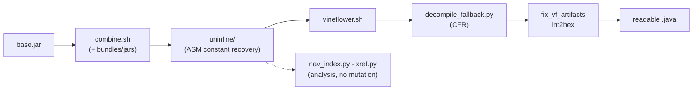

# tools - decompile pipeline & recovery

Everything that turns a converted `.jar` (output of `src/jxe2jar.py`) into *readable* Java.
Grouped by role. Steps 2-7 below are all **optional** refinements - each improves readability
or navigability; none is required for a plain decompile.



| tool | kind | one-liner |
|------|------|-----------|
| [`combine.sh`](#combinesh) | merge | fold the firmware's OSGi bundles + app jars into the lsd base jar (`--appimg`) |
| [`uninline/`](uninline/README.md) | ASM suite | recover inlined `static final` **names** (literal -> `getstatic`), value-verified |
| [`vineflower.sh`](#vineflowersh) | driver | primary decompiler (VF 1.12.0, `jad` renamer, JDK8 runtime) |
| [`cfr.sh`](#cfrsh) | driver | alternate decompiler (CFR 0.152) for cross-referencing |
| [`decompile_fallback.py`](#decompile_fallbackpy) | repair | re-decompile VF stubs with CFR |
| [`cfr_compile_fallback.py`](#cfr_compile_fallbackpy) | repair | replace failed VF files only when CFR source passes javac |
| [`fix_vf_artifacts.py`](#fix_vf_artifactspy) | repair | fix remaining VF rendering errors (keywords, class literals, casts) |
| [`repair_unreachable_clone_catches.py`](#repair_unreachable_clone_catchespy) | repair | remove clone catches proven unreachable by the firmware-JCL compiler |
| [`int2hex.py`](#int2hexpy) | repair | decimal bitmasks/flags -> hex |
| [`foreach1_4/`](#foreach1_4) | repair | enhanced for-each -> Java 1.4 loops (javaparser) |
| [`foreach_compile_fallback.py`](#foreach_compile_fallbackpy) | repair | promote only compiler-passing for-each rewrites |
| [`nav_index.py`](#nav_indexpy) | analysis | "what is value N" / "who uses this constant" index |
| [`xref.py`](#xrefpy) | analysis | bytecode cross-reference (callers/uses/dump) |
| [`recompile_check.py`](#recompile_checkpy) | QA | round-trip gate: does the decompiled source recompile? |

Bundled jars: `vineflower-1.12.0.jar`, `cfr-0.152.jar`, `jd-cli.jar` (unused legacy), plus
`uninline/uninline.jar` (built).

---

## combine.sh

Folds the firmware's OSGi bundles and app jars into the lsd base jar, so the un-inliner sees the
whole closure (cross-corpus constant recovery) and Vineflower resolves all app code intra-jar.
Run between `jxe2jar` and the un-inliner. lsd wins on class-name collisions.

```sh
# --appimg = app image root (.../advanced/<MODEL>-appimg); auto-adds eso/bundles + bundles_prod + hmi/lsd/jars
tools/combine.sh out/base.jar out/combined.jar --appimg /path/to/<MODEL>-appimg
# or explicit sources:
tools/combine.sh out/base.jar out/combined.jar "$APPIMG/eso/bundles" "$APPIMG/eso/hmi/lsd/jars"
```

---

## Constant recovery - `uninline/`

The headline step: `javac` folds `static final` constants into raw literals, so a naive
decompile shows `getChoiceModel(402127)` instead of the symbolic name. The `uninline/` suite
can rewrite a literal load into a candidate `getstatic Owner.FIELD` at the **bytecode** level.
The value check verifies equality, but cannot establish the original source name. Run it on the
converted jar **before** Vineflower. Full detail - tiers, QA, guarantees - in
**[`uninline/README.md`](uninline/README.md)**.

```sh
tools/uninline/build.sh                                                  # build once (JDK 17+)
tools/uninline/uninline.sh pipeline base.jar final.jar doubtful.tsv 100  # sink->T1/T2/T3a->refine->access
tools/uninline/uninline.sh scoped-pipeline base.jar scoped.jar scoped.tsv 100  # fewer inferred names
tools/uninline/uninline.sh heuristic-pipeline base.jar legacy.jar legacy.tsv 100  # broader name guesses
tools/uninline/uninline.sh verify   base.jar final.jar                   # 0 value-mismatch
tools/uninline/uninline.sh audit    final.jar                            # type-ambiguity audit
```

`doubtful.tsv` is a QA sidecar: the low-confidence resolutions `RefineResolve` reverted to
honest numbers (for manual review).

---

## Decompile drivers

### `vineflower.sh`
Primary decompiler. Picks the newest bundled `vineflower-*.jar`, runs it on a **JDK 17+**
(VF 1.12.0 is class-file 61) while pointing `--include-runtime` at the bundled **JDK 8** `rt.jar`,
uses the `jad` variable renamer, and auto-adds `libs/*.jar` as `--add-external` type info.

```sh
bash tools/vineflower.sh final.jar                 # -> final-vf/  (sibling dir)
bash tools/vineflower.sh final.jar out/custom-dir  # custom output dir
VINEFLOWER_JAVA=/path/to/java17/bin/java bash tools/vineflower.sh final.jar   # pin the JDK17+
VF_DECOMPILE_GENERICS=false bash tools/vineflower.sh final.jar out/java4-vf
```

The wrapper propagates the decompiler's failure status through its log pipeline.

Why these choices (both decide the stub count on J9-converted classes):
- `--variable-renaming=jad`, **not** `tiny` - `TinyNameProvider` NPEs during LVT renaming.
- **VF 1.12.0**, not 1.11.2 - 1.11.2's `ExitHelper.cleanUpUnreachableBlocks` NPEs on unreachable
  blocks.

Full option set and the equivalent manual `java ...` command are in the main
[README -> Decompiling with Vineflower](../README.md#decompiling-with-vineflower).

### `cfr.sh`
Alternate decompiler (CFR 0.152), useful for cross-referencing and for methods VF can't
structure. Picks the newest `cfr-*.jar`, applies the sugar/recover option set, and hands CFR the
JDK 8 `rt.jar` + `libs/*.jar` as `--extraclasspath`.

```sh
tools/cfr.sh final.jar out/final-cfr
```

Option set + manual command: [README -> Decompiling with CFR](../README.md#decompiling-with-cfr).

---

## Decompile repair (post-processing)

### `innerclasses/repair.sh`

Some firmware classfiles list an anonymous `$N` class in `InnerClasses` without
its owner. Vineflower then emits a standalone `Outer$N.java` that refers to
synthetic `this$0` fields or private nested types. This ASM pass restores the
owner only when the class captures `this$N` of that exact type, or when the
owner itself constructs the static anonymous class. It also handles flattened
anonymous names such as `Outer$2` capturing `Outer$1`, but only when `Outer$1`
constructs `Outer$2`. Use the repaired JAR for
decompilation only; keep the original final JAR for firmware binaries and
bytecode comparisons.

```sh
bash tools/innerclasses/repair.sh out/final.jar out/final-innerclasses.jar
```

When promoting re-decompiled source, compile the owner and confirm it emits
the same set of class names as the original owner family before removing the
old standalone `$N.java` files. A nested anonymous class can be renumbered by
`javac` (for example, `Outer$2` becomes `Outer$1$1`). In that case, additionally
require a one-to-one class count, preserve every named class, and verify that
no class outside the owner family references the old anonymous name.

The following source repair tools run after Vineflower. They support a dry-run
(default) and `--apply` for in-place changes.

### `decompile_fallback.py`
Vineflower occasionally emits a `// $VF: Couldn't be decompiled` stub for a method whose control
flow its `DomHelper` can't structure (a genuine VF bug, e.g. `com.ibm.oti.util.DefaultPolicy.
loadKeystore`). This scans the decompiled tree for such stubs and, per affected class,
re-decompiles it from the jar with CFR and replaces the `.java`. Needs `cfr-*.jar`.

```sh
python3 tools/decompile_fallback.py out/final-vf out/final.jar --dry-run   # list stubs
python3 tools/decompile_fallback.py out/final-vf out/final.jar             # re-decompile with CFR
```

### `cfr_compile_fallback.py`
For source files that fail the compile check, try CFR on the same classfile. Each CFR result
is compiled on its own against the original JAR; only passing files are eligible for replacement.
The tool tries CFR's default output, then `--sugarboxing false` if the first variant fails.
Use the firmware JCL and `--source 1.4` for runtime-targeted output. A Java 8 gate is useful for
isolating decompiler errors, but does not prove that output runs on the firmware.

```sh
python3 tools/recompile_check.py out/final-vf --jar out/final.jar --json-report out/compile.json
python3 tools/cfr_compile_fallback.py out/final-vf out/final.jar out/compile.json
python3 tools/cfr_compile_fallback.py out/final-vf out/final.jar out/compile.json --apply
```

The fallback also accepts an `isolated_compile_check.py` report and uses its
per-file Java source level. It includes all compiler dependencies in `libs/`.

### `fix_vf_artifacts.py`
The converter now preserves `ACC_SYNTHETIC` on captured `this$N` and `val$...` fields, so
Vineflower reconstructs anonymous captures from bytecode metadata without source rewriting.
This smaller postprocessor handles separate rendering errors: `<unrepresentable>` on standalone
classes, keyword-derived variable names, duplicate intersection casts, raw `toArray(T[])` calls in
any position, old-compiler `class$(String)` calls and both cache-ternary orders
(`f == null ? (f = X.class) : f` and javac 1.1's `f != null ? f : (f = X.class)`), and the
diamond `new X<>()` Vineflower writes even into 1.4 code (Java 7 syntax, raw call on 1.5).

```sh
python3 tools/fix_vf_artifacts.py out/final-vf            # report
python3 tools/fix_vf_artifacts.py out/final-vf --apply    # <unrepresentable> -> Object, etc.
```

### `fix_javac_casts.py`

Decompiling pre-generics bytecode, Vineflower leaves out casts it believes redundant, and javac
answers "incompatible types: Object cannot be converted to T" (or `Object[]` -> `T[]`). The tool
compiles every file alone (`--cp` = the decompiled jar and its dependencies, `--bootclasspath` =
the firmware JCL) and repairs only the reported lines, placing the cast where javac's caret says
the offending expression is:

```java
for (Object name_ : names) {                 // was: for (String name : names) {
    String name = (String) name_;
s = (String) AccessController.doPrivileged(new PrivilegedAction() { ... });
return list.isEmpty() ? null : (String[]) list.toArray(EMPTY);
int v = (Integer) raw.get(0);                // primitives go through the wrapper
```

Files that compile are never touched; `--only-failing report.json` restricts the run to an
isolated-compile report's failures. Found by the round-trip corpus oracle, where these two shapes
were the largest remaining failure classes after `fix_vf_artifacts.py`.

```sh
python3 tools/fix_javac_casts.py out/final-vf --cp out/final.jar --bootclasspath libs/jcl/<FW>/jcl.jar --apply
```

### `decompile_oracle.py`

Measures the decompile stage against ground truth. Takes a javac-built jar (with
`LocalVariableTable`) and its jar2jxe -> jxe2jar round trip (without), decompiles both with
`vineflower.sh` (with `--fix` it runs `fix_vf_artifacts.py` + `fix_javac_casts.py` first),
compiles every file alone against the original jar, and compares the recompiled methods
(`rtdiff.py` normalisation). Reports what fails only without the LVT, what fails on both sides,
and the top javac error categories. Used on the 16-jar corpus (README, "Round-trip corpus").

```sh
python3 tools/decompile_oracle.py --orig orig.jar --rt roundtrip.jar --out out/oracle/foo --fix
```

### `repair_unreachable_clone_catches.py`
Some original classes catch `CloneNotSupportedException` around `clone()`, while the
firmware JCL used for Java 1.4 compilation declares that call without the checked
exception. This report-driven repair replaces only the rejected `try/catch` with
its body as a scoped block. It requires an `isolated_compile_check.py` report;
recompile the changed files afterward.

```sh
python3 tools/repair_unreachable_clone_catches.py out/MU1316-vf-isolated-compile.json
python3 tools/repair_unreachable_clone_catches.py out/MU1316-vf-isolated-compile.json --apply
```

### `int2hex.py`
Decompilers emit all integers in decimal; bitmasks/flags read better in hex (`6291488 -> 0x600020`).
Scores each literal (power of 2, all-ones mask, nibble-aligned, sparse/dense bits, nearby
`&`/`|`/`~` or hex on the line) and converts only those above a threshold.

```sh
python3 tools/int2hex.py out/final-vf                     # report
python3 tools/int2hex.py out/final-vf --apply             # apply (default threshold 2.0)
python3 tools/int2hex.py out/final-vf --threshold 1.0 --apply   # aggressive (config IDs too)
python3 tools/int2hex.py out/final-vf --report report.csv       # CSV for manual review
```

### `foreach1_4`
Vineflower sometimes emits Java 5 enhanced `for` loops for Java 1.4 bytecode.
`RewriteForeach` (javaparser + symbol-solver, bundled jars in the dir) rewrites
selected source files to indexed array loops or `Iterator` loops. It edits the files
in place; loops whose iterable type cannot be resolved are reported and left unchanged.
Recompile the result before use: removing `for-each` syntax can expose other decompiler
errors, including implicit unboxing and raw collection element types.

```sh
java -cp "tools/foreach1_4/*:tools/foreach1_4" RewriteForeach final.jar libs path/to/File.java
```

### `foreach_compile_fallback.py`
Run the same rewrite through a compile gate, without editing the tree during the dry run.
With `--apply`, the tool stages the complete tree and refuses promotion if any previously
passing file fails the full-tree check. It still cannot prove that every decompiled file
compiles: the diagnostic report records each file's first error.

```sh
python3 tools/recompile_check.py out/final-vf --jar out/final.jar --jcl libs/jcl/<FW>/jcl.jar --json-report out/compile.json
python3 tools/foreach_compile_fallback.py out/final-vf out/final.jar out/compile.json --jcl libs/jcl/<FW>/jcl.jar --result out/foreach.json
python3 tools/foreach_compile_fallback.py out/final-vf out/final.jar out/compile.json --jcl libs/jcl/<FW>/jcl.jar --apply
```

---

## Analysis (no mutation)

### `nav_index.py`
After un-inlining, every recovered constant is a real `getstatic Owner.NAME`, so you can finally
ask "what is number N?" and "who uses this constant?". Builds a searchable index from the final
jar (reads constant pools - exact, not text):

```sh
python3 tools/nav_index.py out/final.jar out/nav
```
Writes into `out/nav/`: `constants_by_owner.tsv` (catalog), `constants_by_value.tsv` (value ->
owner.NAME), `const_xref.tsv` (constant -> referrers), `recovery_report.md` (per-package + global
stats). The output dir is an explicit argument - pass a per-image dir (e.g. `out/nav-MU1339`) to
keep runs separate.

### `xref.py`
General bytecode cross-reference (any jar, not just recovered constants). Reads every class's
constant pool - precise, unlike grepping decompiled text.

```sh
python3 tools/xref.py out/final.jar --callers de/.../MapInterface.validateGELicenseState
python3 tools/xref.py out/final.jar --uses    de/.../MapInterface     # what it references
python3 tools/xref.py out/final.jar --dump    xref.txt                # full reverse index
```

### `recompile_check.py`
Round-trip QA gate: recompiles the decompiled `.java` tree (against the stock jar; `-source/-target
1.4` = real runtime level) and reports what fails, classified by artifact. Closes the loop
`jxe -> jar -> uninline -> decompile -> [fixers] -> recompile_check`. Read-only, no fixing.

Pass **`--jcl libs/jcl/<FW>/jcl.jar`** to put the firmware JCL on `-bootclasspath` -- only then
are **method-level** 1.5 APIs caught (e.g. `Class.getSimpleName`, which the CDC 1.1 firmware
lacks but JDK8 has); plain `-cp` resolves `java.lang.*` from JDK8 and misses them. The `--forbid`
bytecode scan still catches forbidden *classes* (`StringBuilder`/`Enum`/`Iterable`).

```sh
python3 tools/recompile_check.py out/final-vf
python3 tools/recompile_check.py out/final-vf --jcl libs/jcl/MHI2Q_US_AUG22_P5087_MU1316/jcl.jar
```
`--json-report PATH` also writes per-file diagnostics for compiler-gated fallback tools.

### `isolated_compile_check.py` and `explicit_unboxing.py`

The full-tree check can hide later errors when an earlier file fails. Also, the
firmware contains JVM-valid class/package name collisions that `javac` cannot
compile as one tree. The isolated check compiles each source in a fresh
task against the original class JAR and reports its first error. It selects
Java 1.4 plus the firmware JCL for original classfile versions 45–48, and
Java 1.5 plus the JDK 8 boot classes for version 49. Put supplemental compiler
dependencies, including JUnit 3.8.2 for bundled test classes, in `libs/`.
The bundled `junit-3.8.2.jar` is the [Maven Central artifact](https://repo.maven.apache.org/maven2/junit/junit/3.8.2/junit-3.8.2.jar)
(SHA-1 `07e4cde26b53a9a0e3fe5b00d1dbbc7cc1d46060`).

```sh
python3 tools/isolated_compile_check.py out/MU1316-vf \
  --jar out/MU1316-final.jar --jcl libs/jcl/MHI2Q_US_AUG22_P5087_MU1316/jcl.jar \
  --version-aware --filter-clashing-classes \
  --json-report out/MU1316-vf-isolated-compile.json
python3 tools/explicit_unboxing.py out/MU1316-vf out/MU1316-final.jar \
  out/MU1316-vf-isolated-compile.json \
  --jcl libs/jcl/MHI2Q_US_AUG22_P5087_MU1316/jcl.jar
```

`explicit_unboxing.py` works on temporary copies. It uses the exact error span
from `javac` to restore explicit wrapper conversion calls where Java 1.4 cannot
use implicit boxing or unboxing. Only individually compiler-passing files are
promoted with `--apply`. A passing isolated check establishes source syntax and
type consistency against the original binaries; it does not prove runtime
equivalence or that all sources can be rebuilt together. Some class/package
collisions require `--filter-clashing-classes`, which temporarily omits the
same-named parent class from that source file's compile classpath. The option
preserves original binary names and reports how many classpaths it filtered.

**`javap` trap** (why trust `--jcl`, not `javap`): `javap -classpath jcl.jar java.lang.Class`
still prints the **JDK8** class (`getSimpleName` present, StringBuilder-based body) because
`java.lang.*` loads from the bootclasspath, not `-classpath`. To inspect the real firmware
class, extract the `.class` from the jar and run `javap` on the **file** (`javap Class.class`) --
the authentic one is StringBuffer-based, has IBM `*Impl` native methods, and no `getSimpleName`.

---

## Not recoverable (ROM-stripped)

Real local/parameter names, line numbers, `StackMapTable`, runtime annotations, `SourceFile` -
proven stripped by the J9 romizer (optional-flags census, 0 across the image). Vineflower's `jad`
type-based names are the ceiling for locals. Generics are **not** stripped - the converter
recovers them (see main [README -> How conversion works](../README.md#how-conversion-works)).
